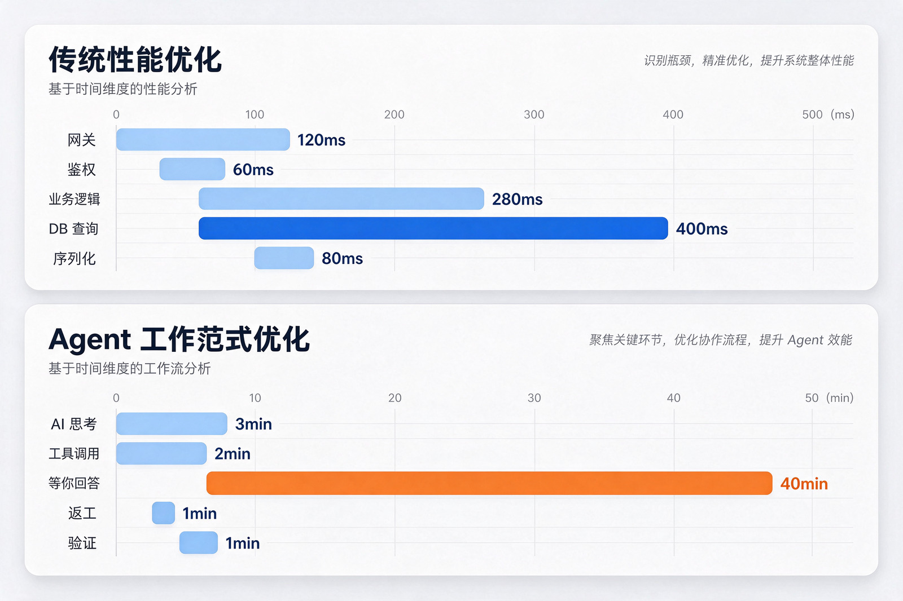
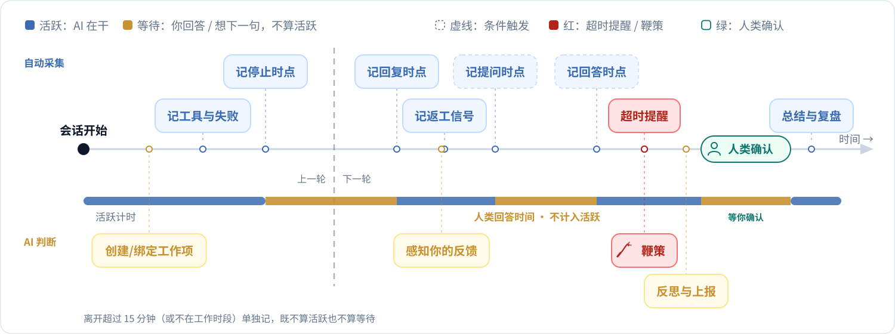
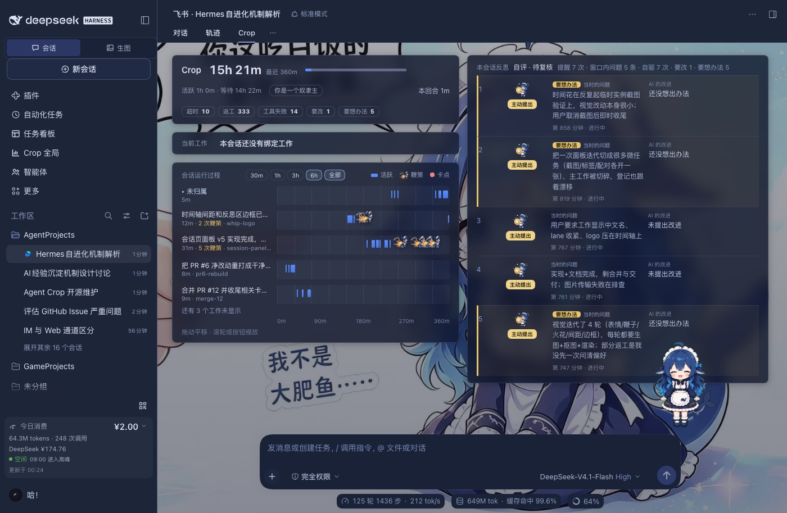
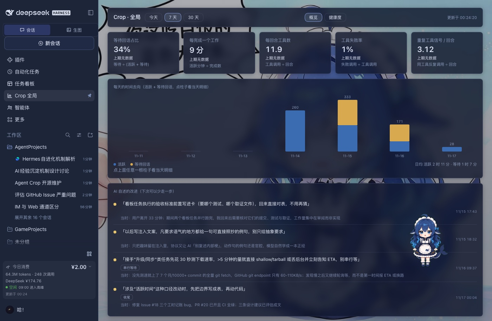
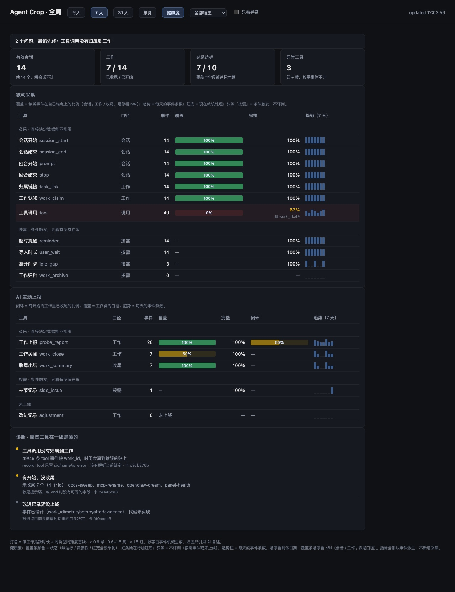
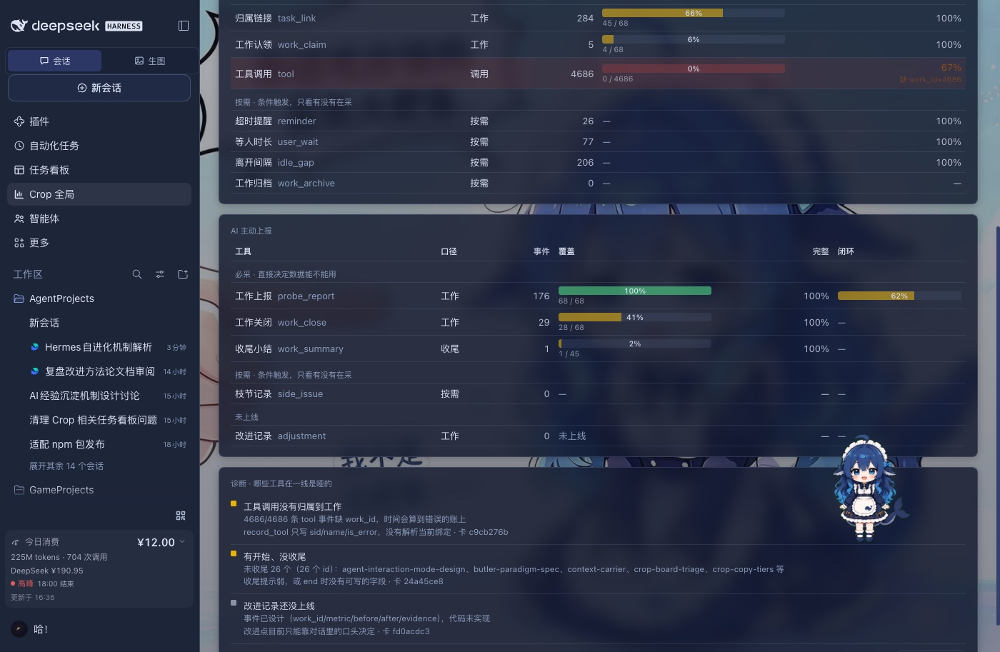

<div align="center">

# Agent Crop


> *"My tokens!!!"*

**Agent Crop is a whip for your AI: make it deliver, make it reflect, make it get better every time you use it.**

<sub>Measure → attribute → optimize → verify · local JSONL · nothing uploaded</sub>

<sub>[中文](README.md) · [English](README.en.md)</sub>

[](https://github.com/oriliz/agent-crop/actions/workflows/ci.yml)
[](https://www.npmjs.com/package/agent-crop-dsh)
[](LICENSE)
[](#install-and-uninstall)
[](#what-it-doesnt-do)

<br>

[Method](#from-backend-performance-tuning-to-agent-workflow-tuning) · [Case study](#case-study) · [Install](#install-and-uninstall) · [Panel](#panel) · [What it records](#what-it-records-and-where)

</div>

---

Your AI coding assistant grinds through an afternoon and hands back a pile of stuff — little of it usable.

It says "Sorry, this one dragged on."

You don't know where that time went. You don't know whether it was slow, or you were thinking.

**Agent Crop exists to answer that question.**

---

## From backend performance tuning to agent workflow tuning

Backend performance work runs on traces: one request per trace, find the most expensive span, fix it, then measure again with the same metric.
That playbook has run in big tech for twenty years — through Double 11, through every production postmortem.

The workplace has the same structure, under the name **retrospective**: what did we do, where did the time go, what do we change next time.

Agent Crop swaps the subject to "a human and an AI working together":



The top is a request's spans; the bottom is where one work block's time went. The four steps don't change: measure, attribute, optimize, verify.

"Self-evolution" here means a **loop backed by data and evidence**:
**measure → attribute → change the instruction / skill / tool → measure again**.
Every retrospective lands as one small, verifiable change — what changed, on what grounds, and whether it worked; `crop ledger` lets the event log do the talking.
The target, the grounds and the effect all sit in front of you: visible, adjustable, reversible at any time.

---

## What the whip does

- **Keep it on track, keep it working.** When the agent has gone quiet for too long or produced no conclusion, prod it: are you on the wrong path?
- **Reflect right away.** After the nudge, make it search the current environment for any time and method still recoverable.
- **Retrospect, self-optimize.** Weekly and monthly self-reviews that turn lessons into methods.

All three together are what makes it self-driven; otherwise it's just being nagged.

### Nudge styles: four personas

Pick one in **Settings → Plugins → Agent Crop → Nudge style** — no restart needed:

| Style | How it nudges | Timeline marker |
|---|---|---|
| Slave driver (default) | All about time and throughput: finish it, ship it | Whale girl getting whipped (whip + burst) |
| Friendly senior | Encouraging: don't grind alone; ask when stuck; say how you'll try first | Neutral: whale girl thinking |
| Experienced colleague | Objective advice: "Want to break it down first? Do the smallest verifiable step" | Neutral: whale girl thinking |
| Hands-off parent | No nudging; let the kid figure it out | No marker |

Only the slave driver actually whips; the other three remind. They don't change how the problem gets solved — only the tone, or who's standing next to you.

---

## Case study

We have an environment-deployment tool with many subcommands. Every time the AI used it, it had to page through `help` layer by layer and then try commands one by one — the matching Skill was incomplete.

Agent Crop recorded it: the same command, repeated `help`, repeated trial and error, filed under `tool-misuse`.

That record was pushed back to the AI for an immediate reflection — it wasn't the model failing to use the tool; the Skill was missing its most important page. The AI then added a handy Skill.

The next time that action came up: **10 minutes became 30 seconds**.

This comes from my own usage, and it genuinely helped me. But it is not a rigorous evaluation — the tool is still under development, so please bear with us. Still, I believe the methodology holds.

The same symptoms show up as: starting before clarifying (`spec-drift`), refusing to stop when the job can't be done (`no-evidence`), serial waiting (`serial-wait`). Nine categories in all — see [docs/EVENTS.md](docs/EVENTS.md).

---

## How Crop works

In one sentence: it only steps in at a few points.

Its core is a single line: remind → reflect → change the way it works → get back to it.

Lay one conversation out from left to right:



- **Start**: the session begins. The probe first injects one line into context — **create / bind a work item** — and only then starts recording.
- **Every working turn**: each tool call records its name and whether it passed.
- **End of a turn**: record the stop point (`stop`, the active minutes of the turn).
- **Your next message**: record the reply time — gaps between turns ≤15 minutes count as "waiting"; anything longer, or outside working hours, becomes `idle_gap` (away — counted on neither side); then **sense your feedback**: bring your comment and the workspace state into context; and keep an eye on **rework signals** (the same tool over and over, the same spot edited back and forth).
- **While the AI is asking**: record a timestamp before and after; the gap is **your answering time** — yellow on the chart, not counted as AI active time. Blue is active, yellow is waiting, the same palette as the stacked bars in the panel.
- **Timeout**: record a timeout reminder, then inject a nudge (the red pair on the chart — with a tiny whip); after the lashing the AI must **reflect and report** — call `crop_update` with `cause` / `verdict` / `category`, the only action the AI adds on its own in the whole chain.
- **Before wrap-up, ask you**: the only "human feedback" node in the chain — whether the work is done is your call; the time spent waiting for you is yellow too.
- **Summary and retrospective**: written only after you confirm (what was done, where it went, what to save next time), stored as `work_summary`.

Turns are separated by a dashed vertical line: left is the previous turn, right is the next. The green "human confirmation" is the only human-feedback node. Not every point fires: dashed frames are conditional triggers — a waiting segment exists only when the AI asks, a nudge only at the yellow / red lines (the red pair).

The chart speaks plain language; the table gives the field names, so you can read it next to the code:

| When | Injected / nudged | Collected | Condition |
|---|---|---|---|
| Session start | Create / bind a work item | — | Start of every session |
| Every tool | — | `tool`: name, pass/fail | Every tool return |
| End of turn | — | Stop point: `stop` (active minutes of the turn) | Every turn |
| Your next message | Sense your feedback: your comments / workspace state into context | Reply time: `prompt`; gap ≤15 min → `user_wait`, longer → `idle_gap` | Every turn |
| Repeated tools | — | Rework signals `tool_churn` / `rework_signal` | Same tool or same spot repeating |
| AI asks | Timestamp before and after the question | `user_wait`: the difference | Ask-type tool used |
| Timeout | One nudge (whip included) | `reminder` | Yellow / red line |
| After timeout | AI reflects and reports: `phase="blocked"` + `cause` / `verdict` / `category` | — | After the nudge |
| Before wrap-up | Human confirmation (done or not is your call) | `user_wait`: time waiting for you | Before closing a work item |
| Summary & retrospective | — | `work_summary`: what / cost / next_time | After you confirm |

In one line: **the probe records facts, the AI fills in judgments** — stored separately, and the panel puts the two side by side.

---

## Panel

Two entry points: **the Crop tab on the session page** for how one session ran, and **Crop global in the sidebar** for cross-session friction metrics and collector health.

**Session-page Crop** — how this session is going:

- At the top: the session clock (active / waiting) and this turn's time; the current work item carries an estimated-progress bar.
- The timeline is laned by work item: each active stretch is a blue bar, each nudge is a whale-girl sticker with a count (clustered within 5 minutes), each blockage is a red dot; click a stretch to see how long it took.
- Below are the work items touched in this session and the AI's reflections and improvements, in four columns — number / source / the problem at the time / the AI's improvement. The source column separates "whipped" from "raised on its own · summarized on its own"; self-driven entries get a whale-girl medal.



**Sidebar Crop global** — the cross-session side: share of time waiting for a reply, minutes per completed work item, tools per turn, tool failure rate, repeated-tool signal density; then each day's time budget (active + waiting stacked bars — click a bar for that day's breakdown), improvements the AI described, pitfalls still repeating, and the work list.



**The "Health" view inside Sidebar → Crop global** (frosted-glass panel, wallpaper showing through) — it doesn't ask what you did this week; it asks whether **the collector itself has gone silent**.

- Four cards on top: valid sessions, wrap-up ratio, required-field compliance, anomalous tools.
- **Health composition**: a donut shows at a glance how much is healthy and how much needs attention, with legend counts (normal / low / needs attention / on-demand + not live) and one "fix this first" line next to it.
- Two tables: passive collection and AI self-reports, grouped by "required / on-demand / not live".
- Coverage and closure are colored bars: green meets the threshold, yellow is low, red was never collected; the percentage sits inside the bar, n/N below it; rows with a red bar get a red background.
- The trend is a small bar chart of daily event counts; missing fields are labeled "missing work_id ×N".
- "Only anomalies" collapses the normal rows; the host dropdown splits dsh / claude-code.
- The diagnostics list at the bottom is generated per metric, each item with a panel card; "copy fix instruction" assembles a paragraph you can drop straight into an AI.





The same health data is exposed to AI and to scripts:

```bash
crop health --days 7          # for humans: one-line verdict + issues + one row per tool
crop health --json            # for machines: full health_summary
```

- DSH plugin: the `crop_health` tool (`days` / `host`); call it whenever you doubt the data.
- Claude Code (MCP): `crop_health`, exposed next to `crop_update`.

Four honest caveats:

- The global page only has stacked bars — no filters, comparison tables or export; Health has tables and "only anomalies", but still no export.
- Data coverage is low: `type`/`difficulty` are often empty, and `verdict`/`rework`/`improve` have even fewer samples, so "vs. last period" often says "no data for the previous period".
- The next step is to tighten the protocol (record the type at start, require a judgment at wrap-up) before talking trends and attribution — otherwise the panel can only give you "totals", not "improvement".
- Health thresholds (coverage ≥ 80%, field completeness ≥ 95%) are first guesses, not calibrated on real data; with fewer than 3 sessions it only reports "too few samples" and draws no conclusion.

---

## Install and uninstall

```bash
dsh plugin --profile <your profile> add agent-crop-dsh
# restart dsh; new sessions pick it up
```

The npm install ships prebuilt artifacts: no build scripts on your machine, and no pnpm `allowBuilds` permission needed.

No config changes, no `AGENTS.md` edits — the protocol is registered into the system prompt by the plugin and removed on uninstall.

To change the source, clone and link instead:

```bash
git clone https://github.com/oriliz/agent-crop.git ~/agent-crop
dsh plugin --profile <your profile> add ~/agent-crop
```

For Claude Code, see [docs/INSTALL.md](docs/INSTALL.md).

Self-check (the `crop` command ships with the npm package, but `dsh plugin add` doesn't put it on PATH):

```bash
npm i -g agent-crop-dsh   # optional: puts crop on PATH
crop status                              # the last line prints the real data directory
tail -1 ~/.agentcrop/data/events.jsonl   # should contain "host":"dsh"
```

> The data directory used to be called `~/.ai-coding-efficiency`; the new name is `~/.agentcrop`. If the new one isn't on your machine yet, the last line of `crop status` prints the real path; to unify the name, run `ln -s ~/.ai-coding-efficiency ~/.agentcrop`, or override with `KIT_SHARED_HOME`.

Don't want a global install? Run the command from the package directly:

```bash
npx --yes --package=agent-crop-dsh -- crop status
```

Uninstall:

```bash
dsh plugin --profile <your profile> remove agent-crop-dsh
# Claude: claude plugin uninstall agent-crop@agent-crop
```

Uninstalling leaves data untouched. To wipe it too: `rm -rf ~/.agentcrop`

---

## What it records, and where

### Recorded by the host automatically

| When | What |
|---|---|
| Session start / you send a message | Workspace, task-block start |
| Every tool return | Tool name, pass or fail |
| End of turn | How long the turn ran |
| Your next message | How long it waited for you; over threshold → `idle_gap` |
| Red line crossed | A reminder was injected |
| Same tool / file failing repeatedly | Rework signal |

### Reported by the AI

| Field | Filled when | Possible values |
|---|---|---|
| `phase` | Every report | `start` begin / `progress` progress / `blocked` stuck / `end` wrap-up |
| `task_id` | Every report | The short name you gave the work item, e.g. `refactor-auth` |
| `summary` | Every report | One line: what it's doing now |
| `cause` | Required for `blocked` | One line: why it's slow, where it's stuck |
| `next` | Optional | The concrete next action |
| `category` | Required for `blocked` | One of nine: `serial-wait` `repeat-pitfall` `design-churn` `decision-batching` `tool-misuse` `no-evidence` `spec-drift` `human-wait` `other` |
| `goal` | At start | One-line objective |
| `type` | At start | `design` / `implement` / `debug` / `docs` / `explore`, or a custom lowercase slug (e.g. `research`) |
| `difficulty` | At start | `s` / `m` / `l` |

`category` is an enum, not free text — a wrong value fails outright. The nine-word vocabulary is locked, so the record never drifts.

These are judgments, not facts: **self-reports never stand as a conclusion on their own**; read them against the automatically collected timestamps and failure counts.

Data goes only to `~/.agentcrop/data` on this machine (mode 0700), overridable with `KIT_DATA_DIR`. Conversation bodies are not stored.

---

## Cost

A little extra token spend, almost no speed impact.

- **One extra line per turn**: 100–300 characters injected; when stuck the AI reports once, about 50–100 tokens.
- **No re-reading the conversation**: summaries are built from structured events; the whole session is never fed back to the model.
- **No delay**: one line injected, one sentence reported — milliseconds.

A 20-turn work block totals about 2k tokens. Compare reading back through the session afterwards: a medium session is tens of thousands of tokens, a long one hundreds of thousands — it simply won't fit in context.

---

## What it doesn't do

- **No scoring.** No efficiency score, no leaderboard.
- **No upload.** Data stays on this machine.
- **No touching your code.** Observe only; suggestions only affect prompts.
- **Not an APM.** In-process performance still belongs to OpenTelemetry.
- **Not for your boss.** No cloud, no team dashboard.

This is a mirror, not a judge.

---

## Docs

- [docs/DESIGN.md](docs/DESIGN.md) — design principles and boundaries
- [docs/EVENTS.md](docs/EVENTS.md) — which events are collected, how they're stored, who uses them
- [docs/SESSION-WORK.md](docs/SESSION-WORK.md) — how sessions and work items bind and unbind, and what to do when the binding goes stale
- [docs/INSTALL.md](docs/INSTALL.md) — install and uninstall on four hosts
- [docs/LONGEVITY.md](docs/LONGEVITY.md) — how to survive context washout on long tasks

## License

MIT — use it, change it.

---

<div align="center">

**Why talk when you can act?** 😏


*feel free to contribute*

</div>
