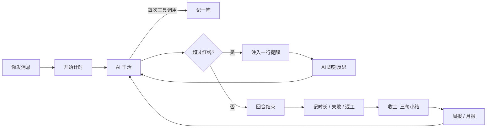
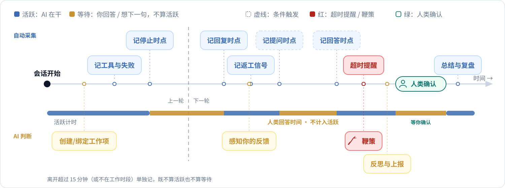

<div align="center">

# Agent Crop


> *「我的 Token 啊！！！」*

**Agent Crop 是给 AI 的一根马鞭：催它交活，逼它复盘，让它自己越用越顺。**

<sub>测量 → 归因 → 优化 → 验证 · 本地 JSONL · 不上传</sub>

[](https://github.com/oriliz/agent-crop/actions/workflows/ci.yml)
[](LICENSE)
[](#安装与卸载)
[](#它不做什么)

<br>

[方法论](#从传统性能优化到-agent-工作范式优化) · [案例分析](#案例分析) · [安装](#安装与卸载) · [探针插在哪](#一次对话里的探针与工具) · [面板](#面板v0还很简陋) · [它记了什么](#它记了什么在哪记)

</div>

---

你的 AI 编程助手跑了一个下午，产出两行代码。

它说「抱歉，这个拖得有点久」。

你不知道那两小时去哪了。你不知道是它慢，还是你在想。

**Agent Crop 就是来回答这个问题的。**

---

## 从传统性能优化到 Agent 工作范式优化

后端做性能优化靠 Trace：一次请求一条，找到最贵的那一段，改完再用同一个指标测一遍。
这套东西在大厂跑了二十年，撑过双十一，也撑过每一次线上事故复盘。

职场里也有同一套结构，叫**复盘**：做了什么、时间花在哪、下次怎么改。

Agent Crop 只是把对象换成了「人和 AI 一起干活」：


上图是一次请求的 span，下图是一次工作的时间去向。四步不变：测量、归因、优化、验证。

---

## 马鞭做什么

- **防跑偏、防摸鱼。** Agent 长时间没回话、没给出结论的时候，鞭策它想一想：是不是走错了路。
- **即刻反思。** 被鞭策之后，要求它在当下的环境里找一找，还有没有能挽回的时间和方法。
- **复盘，自驱优化。** 通过周报、月报做自我反思，自己沉淀方法论。

三件事凑齐才叫自驱，不然只是被催。

---

## 案例分析

我们有个环境部署工具，子命令很多。AI 每次用都得先 `help` 一层层翻，再挨个试——对应的 Skill 写得不完整。

Agent Crop 把这件事记了下来：同一个命令反复翻 help、反复试错，归到 `tool-misuse` 这一类。

这条记录被推回给 AI，让它即刻反思——不是模型不会用，是这个 Skill 缺了最关键的一页。它据此补了一份常用 Skill。

同一个动作，下一次：**10 分钟，变成 30 秒**。

这是我个人使用中的一个成果，它确实帮到了我。但它还不是一个完善的测评——这个工具还在开发中，请大家多多包容。不过我相信，这样一套方法论是行之有效的。

同样的症状还有：没问清楚就开始干（`spec-drift`）、做不到也不停手（`no-evidence`）、串行等待（`serial-wait`）。一共九类，见 [docs/EVENTS.md](docs/EVENTS.md)。

---

## Crop 是如何工作的

一次工作里，它只在几个点上出手。



那条回到「AI 干活」的环，就是马鞭：提醒 → 反思 → 改工作方式 → 再干。

---

## 一次对话里的探针与工具



一条线就是一次对话。**上面是采集**（探针自动记，不打扰 AI），**下面是影响**（往它的上下文里塞一句话）。

- 采集：开始计时 · 记工具 · 记等待 · 记提醒 · 记时长 · 收工三句话
- 影响：先认领或跳过 · 每轮一句状态 · 没认领就提醒 · 到点催

两个细节：

- **不是每个点都发生。** 虚线的是条件触发：用了 ask 工具才有「记等待」，到黄线/红线才「到点催」，工具用了却还没认领才「没认领就提醒」。
- **上下不必对齐。** 计时从你发消息那刻开始，认领是 AI 下一步才做的；图里的位置就是它真实发生的先后。

图里说人话，表里给对应的字段名，方便对着代码看：

| 时间点 | 采集（自动） | 影响（注入的一句话） | 什么时候 |
|---|---|---|---|
| 开场 | `prompt`，开一个计时块 | — | 每次发消息 |
| 首轮 | — | 先认领，或明确跳过 | 每次会话第一次 |
| 每轮开头 | — | 一句状态：工作、已用时长、黄线余量 | 每轮第 1 步 |
| 每次工具 | `tool`：名字、成功/失败；同工具反复 → 返工信号 | 没认领就提醒：先绑定再动手 | 每次工具；未认领时 |
| 等你回话 | `user_wait`：ask 工具起止的等待时长 | — | 用了 ask 类工具 |
| 到点 | 记一次提醒 | 催它说卡点：`phase="blocked"` + `cause`/`verdict`/`category` | 黄线 / 红线 |
| 回合结束 | `stop`：这一块的活跃分钟；漏报记 `miss` | — | 每轮结束 |
| 收工 | `work_summary`：what / cost / next_time | — | 关闭工作时 |

一句话：**探针只记事实，AI 只填判断**；两边分开存，面板再把两边摆在一起看。

---

## 面板（v0，还很简陋）

现在有两个入口，都是**早期版本**：只有几张卡、几个数字，先解决「时间花在哪、卡在哪」，不是成品 BI。

**会话页 Crop 页签**——这一个会话的现在：当前工作与用时、AI 对自己慢在哪的判断、工具排行、最近几轮的形状。

**侧边栏 Crop 全局**——跨会话的那一面：等待回话占比、每完成一个工作多少分钟、每回合工具数、工具失败率、重复工具信号密度；下面是每天的时间去向（活跃 + 等待堆叠柱，点柱子看当天明细）、AI 自述的改进、还在重复的坑、工作列表。

诚实说三点：

- 指标还很少，图只有堆叠柱；没有筛选、对比表、导出。
- 数据覆盖率不高：`type`/`difficulty` 经常空着，`verdict`/`rework`/`improve` 的样本更少，所以「上期对比」经常显示「上期无数据」。
- 下一步先补协议（开工落类型、收尾必填判断），再谈趋势和归因——不然面板只能给你「总量」，给不了「提升」。

两个面板都是 DSH 原生界面（会话页 tabs + 侧边栏 panel + 同源 `/api/agent-crop/*`），**没有独立的 dashboard 进程**；卡片沿用当前皮肤的半透明材质。

---

## 安装与卸载

```bash
git clone https://github.com/oriliz/agent-crop.git ~/agent-crop
dsh plugin --profile <你的 profile> add ~/agent-crop
# 重启 dsh，新会话生效
```

装完不用改配置、不用动 `AGENTS.md`——协议通过插件注册进系统提示，卸载时自动移除。

Claude Code 的装法见 [docs/INSTALL.md](docs/INSTALL.md)。

自检：

```bash
crop status                              # 最后一行会打印真实数据目录
tail -1 ~/.agentcrop/data/events.jsonl   # 应出现 "host":"dsh"
```

> 数据目录的历史名是 `~/.ai-coding-efficiency`，新版叫 `~/.agentcrop`。如果你的机器上还没有后者，`crop status` 最后一行打印的才是真实路径；想统一名字就 `ln -s ~/.ai-coding-efficiency ~/.agentcrop`，或用 `KIT_SHARED_HOME` 覆盖。

`crop` 是仓库里的脚本，先放进 PATH：

```bash
ln -sf ~/agent-crop/bin/crop /usr/local/bin/crop
```

卸载：

```bash
dsh plugin --profile <你的 profile> remove agent-crop-dsh
# Claude: claude plugin uninstall agent-crop@agent-crop
```

卸载不动数据。要一起清掉：`rm -rf ~/.agentcrop`

---

## 它记了什么、在哪记

### 宿主自动记

| 什么时候 | 记什么 |
|---|---|
| 会话开始 / 你发消息 | 工作区、任务块起点 |
| 每次工具返回 | 工具名、成功还是失败 |
| 回合结束 | 这一轮跑了多久 |
| 你下一次开口 | 等了你多久；超阈值记 `idle_gap` |
| 超红线 | 提醒注入了一次 |
| 同工具 / 文件反复失败 | 返工信号 |

### AI 主动报

| 字段 | 什么时候填 | 可能的值 |
|---|---|---|
| `phase` | 每次上报 | `start` 开工 / `progress` 有进展 / `blocked` 卡住 / `end` 收工 |
| `task_id` | 每次上报 | 你给这件事起的短名，比如 `refactor-auth` |
| `summary` | 每次上报 | 一句话：现在在做什么 |
| `cause` | `blocked` 必填 | 一句话：为什么慢、卡在哪 |
| `next` | 可选 | 下一步的具体动作 |
| `category` | `blocked` 必填 | 九选一：`serial-wait` `repeat-pitfall` `design-churn` `decision-batching` `tool-misuse` `no-evidence` `spec-drift` `human-wait` `other` |
| `goal` | 开工时 | 一句话目标 |
| `type` | 开工时 | `design` / `implement` / `debug` / `docs` |
| `difficulty` | 开工时 | `s` / `m` / `l` |

`category` 是枚举，不是自由文本——填错直接失败。九类词表锁死，不会越记越乱。

这些只是判断，不是事实：**自述永远不单独当结论**，要和自动采集的时间、失败数对照着看。

数据只落本机 `~/.agentcrop/data`（权限 0700），可用 `KIT_DATA_DIR` 覆盖。不存对话正文。

---

## 成本

只多花一点 Token，对速度几乎无感。

- **每回合多一行**：注入 100–300 字符；卡住时 AI 上报一次，约 50–100 token。
- **不重读对话**：总结基于结构化事件，不会把整段会话再塞回模型。
- **不拖时间**：注入一行、上报一句，都是毫秒级。

一个 20 回合的工作，合计约 2k token。对比事后去会话里反查——一条中等会话就是几万 token，长的几十万，根本塞不进上下文。

---

## 它不做什么

- **不打分。** 没有效率分，没有排行榜。
- **不上传。** 数据只在这台机器上。
- **不改你的代码。** 只观察；方案也只影响提示。
- **不替代 APM。** 工具内部性能仍归 OpenTelemetry。
- **不给你老板看。** 没有云，没有团队看板。

这是镜子，不是裁判。

---

## 文档

- [docs/DESIGN.md](docs/DESIGN.md) — 设计原则与边界
- [docs/EVENTS.md](docs/EVENTS.md) — 采哪些事件、怎么存、谁在用
- [docs/SESSION-WORK.md](docs/SESSION-WORK.md) — 会话与工作怎么绑定、怎么解绑、失效了怎么办
- [docs/INSTALL.md](docs/INSTALL.md) — 四个宿主的安装与卸载
- [docs/LONGEVITY.md](docs/LONGEVITY.md) — 长任务里怎么不被上下文冲刷掉

## License

MIT — 随便用，随便改。

---

<div align="center">

**能动手的事，为什么要动口呢？** 😏


</div>
