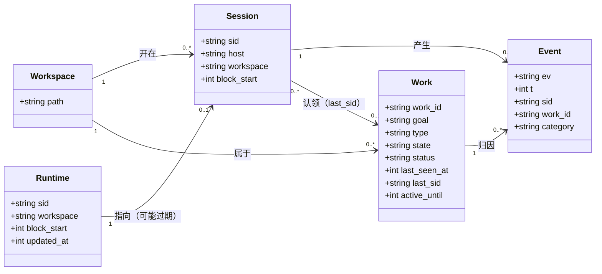

# 会话 ↔ 工作的绑定

> 这份文档只回答一个问题：**一次会话里发生的事，怎么归到一条工作上。**
> 没有这层映射，事件流只是散点；有了它，才能做上下文分析（一次工作跨了几轮、几个会话、卡在哪一类）。

## 0. 三个实体

| 实体 | 是什么 | 谁分配 | 生命周期 |
|---|---|---|---|
| **会话** `sid` | 一次对话 | 宿主 | 会话创建到结束（重启会变） |
| **工作** `work_id` | 一件事 | AI 上报时给 | 可跨会话、跨天，直到关闭/归档 |
| **认领** claim | 本会话当前在看哪条工作 | AI（`probe_report` / `crop switch`） | 可持续，可换 |

关键区别：**工作还在不在（state）** 和 **本会话在看哪条（claim）** 是两件事。切走焦点不等于暂停工作。

### 类图



读图要点：

- **认领不是一张独立的表**，它是 `Work` 上的 `last_sid` + `active_until` 两个字段。
- 一个会话在任一时刻只认领**一条**工作（`0..1`）；一条工作可以被多个会话先后认领，但 `last_sid` 只存最后一个。
- `Event` 同时挂 `sid` 和 `work_id`：前者回答“哪次会话”，后者回答“哪件事”。**两个都有的才是完整的账。**
- `Runtime` 是活动指针，不是真相来源——它会过期，所以不能只靠它判断当前会话。

## 1. 数据落在哪

| 文件 | 存什么 | 在映射里的角色 |
|---|---|---|
| `data/events.jsonl` | 每条事件带 `sid`，AI 的报告还带 `work_id` | 事实流 |
| `data/tasks/open.json` | 任务表：`last_sid`、`active_until`、`state`、`last_seen_at` | **绑定表** |
| `data/runtime/current.json` | 当前 `sid` / `workspace` / `block_start` | 活动指针 |

任务对象里与绑定有关的字段：

| 字段 | 含义 | 谁写 |
|---|---|---|
| `last_sid` | 最后一次认领它的会话 | `probe_report` / `crop switch` |
| `active_until` | 认领的有效期（默认 2 小时） | `probe_report` |
| `last_seen_at` | 最后一次上报时间 | `probe_report` |
| `state` | `open` / `suspended` / `archived` | `crop suspend/resume/archive` |
| `status` | `open` / `closed` | 关闭时移除 |

## 2. 绑定的三个入口

1. **AI 上报**（主路径）：调 `probe_report(task_id=...)` → 写 `last_sid = 当前会话`，刷新 `active_until`。
2. **显式切换**：`crop switch <work_id>` → 只改 `last_sid`，不动状态，也让这条成为本会话的当前工作。
3. **继承**（兜底）：本会话没有认领记录时，若恰好只有一条 `active_until` 未过期的工作，视为同一条。用于重启/fork 后会话 ID 变化。

## 3. 解析算法

每次注入状态行前执行：

```text
candidates = 该工作区内 status=open 且 state=open 的任务，按 rank 排序
rank = (是否本会话认领, 是否同工作区, -last_seen_at)

claimed = candidates 中 last_sid == sid 的第一条
if claimed:
    return "当前工作：claimed"
active = candidates 中 active_until > now 的
if len(active) == 1:
    return "当前工作：active（上个会话认领，仍在有效期内）"
return "未完成的工作：前 3 条候选……由 AI 认领"
```

**程序不替 AI 选。** 只有在“根本没有认领”且“活跃工作不唯一”时，才退化成候选列表让 AI 判断。

## 4. 一次绑定的时序

```mermaid
sequenceDiagram
    participant U as 用户
    participant H as 宿主(DSH)
    participant P as 插件
    participant C as core(python)
    U->>H: 发一条消息
    H->>P: agent/pre-step(payload.agent.session)
    P->>P: sid = session.id; workspace = session.header.cwd
    P->>C: work_status(sid, workspace)
    C->>C: last_sid 命中？否则单条 active_until 继承？否则候选
    C-->>P: 一行状态文本
    P-->>H: 注入到本次 pre-step
    Note over P,C: 会话首轮只注入 start_hint，第二轮起才注入状态行
```

另一个宿主（Claude Code）走 stdio hook，`probe_hook.py` 从 stdin JSON 的 `session_id` 取同一个值。

## 5. 多会话规则

- 每个会话的认领**互相独立**：`last_sid` 是谁，状态行就显示谁。
- 同一条工作可以被多个会话先后认领——**后认领的覆盖前一个**（`last_sid` 只有一个槽位）。这是当前限制。
- 多个会话同时活跃时，各自的 `active_until` 都有效，继承分支会因为“不唯一”而退化成候选列表，这是有意的。

## 6. 失效与自愈

| 现象 | 原因 | 现在怎么处理 | 还缺什么 |
|---|---|---|---|
| 状态行总显示最旧的任务 | 只按工作区排序，落回插入顺序 | 改成 会话 > 工作区 > 最近活动 | — |
| fork / 重启后认领丢失 | 会话 ID 变了 | `active_until` 单条继承 | 显式传递 parent sid |
| 上报和注入的 sid 不一致 | 两条路径来源不同 | 上报时校正 `runtime.sid` | 统一成单一来源 |
| 暂停了但还列在进行中 | `state` 与 `status` 字段不一致 | 查询同时看两个字段 | — |
| subagent 的会话 | 子会话有自己的 sid | **未处理** | 继承父会话的 work_id |

## 7. 验证方法

```bash
crop status                       # 进行中的工作 + 当前块
crop switch <work_id>             # 只换焦点，不改状态
crop suspend <work_id>            # 真的不做了
crop resume <work_id>             # 继续
```

看解析结果（不发注入，只跑算法）：

```bash
python3 -c "
import sys; sys.path.insert(0,'core')
import probe_core as c
r = c.read_runtime()
print(c.work_status_line(r.get('workspace'), r.get('sid')))
"
```

## 8. 待补

- **显式映射表**：现在靠任务上的 `last_sid` 反查，是 O(n)；工作多了应该单独一张 `sessions → claim` 表。
- **subagent 继承**：子会话应该继承父会话的 `work_id`，现在会当成独立会话。
- **认领冲突**：同一条工作被两个会话同时认领时，目前是静默覆盖，应该记录冲突事件。
- **fork 的父子关系**：现在只能靠 `active_until` 猜，宿主如果能给出 parent sid，应该直接继承。
